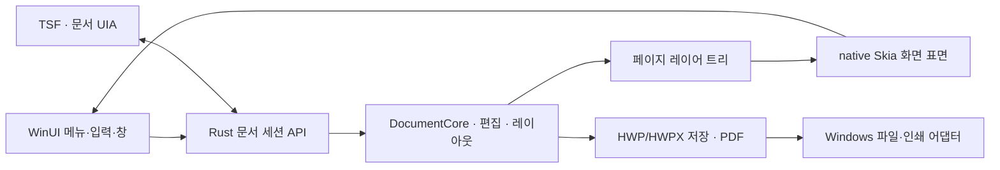

# Windows 전용 native 편집기 전환 가능성

작성일: 2026-10-11. 조사 기준: OpenGeul `4e16b9b517d5c4dce10ae7a05d27535995197a78`, HOP 0.4.5, rhwp 0.8.7. 이 문서는 다음 개발 방향을 평가하는 연구이며, 현재 릴리스에 UI 재작성을 추가하지 않는다.

## 판단과 권장 방향

**WebView 없이 Windows native 편집기를 만드는 것은 가능하다.** HWP/HWPX 파싱·편집·레이아웃·저장을 담당하는 Rust 엔진을 재사용할 수 있다. 권장 시험 구조는 **C++/WinRT WinUI 3 화면 + Rust 문서 엔진 + native Skia 문서 그리기**다. 일반 메뉴와 대화상자는 WinUI에 맡기고, 문서 페이지는 별도의 그리기 표면에 표시한다.

현재 편집기의 입력·선택·실행 취소·스크롤·도구 모음은 TypeScript와 DOM/Canvas에 상당 부분 구현되어 있다. 따라서 WebView 제거에는 새 편집기 호스트 개발이 필요하다. 특히 한글 조합 입력과 문서 접근성이 핵심 일정 요인이다. Rust 엔진을 Windows 코드로 다시 작성할 필요는 없다.

이 구조가 현재 제품보다 얼마나 빨라지는지는 아직 측정하지 않았다. 목표를 실행 시간, 첫 페이지 표시, 입력 반영, 스크롤 지연, 메모리로 나눠 비교해야 한다. 문서 전체 재배치나 글꼴 처리에 시간이 대부분 쓰인다면 UI 런타임 교체만으로 그 비용이 없어지지는 않는다.

먼저 동일한 문서를 여는 **native 읽기 전용 시험판**과 **한 페이지 한글 편집 시험판**을 별도 프로젝트에서 비교한다. 시험 결과로 화면 기술과 후속 투자 규모를 결정한다. 기존 편집기와 저장 검증은 그동안 유지한다.

## 실제 코드에서 확인한 재사용 경계

버전과 커밋의 기준은 [업스트림 고정 파일](../config/upstream.lock.json)이다. 아래 경로는 해당 커밋의 HOP/rhwp 소스와 OpenGeul의 실제 통합 패치를 함께 확인한 결과다.

| 계층 | 현재 구현과 근거 | native 전환 시 처리 |
| --- | --- | --- |
| 문서 엔진 | rhwp `DocumentCore`, 파서, 편집 변이, 레이아웃 및 HWP/HWPX 내보내기 | 같은 Rust 구현 재사용. WASM 대신 native 라이브러리 호출 |
| 엔진 어댑터 | HOP `apps/desktop/rhwp-adapter/src/lib.rs`가 `DocumentCore`와 편집·PDF 경계를 노출 | Windows 호스트용 작은 C ABI 또는 C++ 연결 계층 추가 |
| 현재 화면 상태 | `TauriBridge extends WasmBridge`; 열기에서 `loadDocumentForOpen`, 저장에서 `super.exportHwp()` / `super.exportHwpx()` 호출 | 활성 편집 문서의 상태를 native Rust 세션에 두고, 화면·저장 모두 같은 세션을 참조 |
| 화면 렌더링 | HOP `host/renderer-session.ts`가 `canvas2d`를 고정하고 CanvasKit 로딩을 거부 | WebView 밖의 페이지 표면과 그리기 수명 주기를 새로 구현 |
| native 그리기 | rhwp `build_page_layer_tree`와 `native-skia`의 PNG 출력 경로 | 페이지 레이어 트리와 Skia 재사용 검토. 실시간 표면용 API는 추가 작업 필요 |
| 입력·커서 | rhwp-studio `InputHandler`, 숨겨진 `textarea`, composition/input 이벤트, DOM/SVG 커서·선택 영역 | Windows 입력·좌표·조합 상태와 문서 위치의 연결을 이식 |
| 실행 취소 | TypeScript `engine/history.ts::CommandHistory`가 명령과 Rust 스냅샷을 관리 | Rust 스냅샷뿐 아니라 명령 순서, 병합, 선택 복원, 수명 관리도 이식 |
| 파일 저장 | HOP native `state.rs`의 세션·revision·외부 변경 검사·원자적 저장, OpenGeul HWPX 저장 패치 | UI 대화상자 의존성을 분리하고 저장 정책을 동일하게 유지 |
| PDF·인쇄 | Rust PDF 내보내기와 Tauri의 `print_webview`가 서로 다른 경로 | PDF 코어 재사용. WebView 인쇄 대신 Windows 인쇄 어댑터 구현 |

현재 화면의 문서 편집은 WASM에서 수행된다. native 측 추적 세션은 경로·revision·dirty 상태를 관리하고, 저장 검증이나 PDF 작업에서 native 코어를 사용한다. 따라서 현재 제품을 이미 완성된 native 편집 화면으로 볼 수는 없다. 반대로 Rust 코어가 native에서 실행 가능한 사실은 기존 CLI와 native 어댑터에서 확인된다.

특히 Skia의 `render_page_to_canvas_strict`는 rhwp 0.8.7에서 **`pub(crate)`**다. 외부 GUI가 해당 함수에 곧바로 연결할 수 있는 공개 화면 API는 아니다. PNG 생성 API로 화면 시험을 시작할 수 있지만, 매 프레임 PNG 인코딩·디코딩을 거치는 구조를 최종 성능 설계로 채택해서는 안 된다. 화면용 표면에 페이지 레이어 트리를 직접 재생하는 좁은 API를 설계하고, 기존 클리핑·글꼴·리소스 오류 처리 정책을 보존해야 한다.

현재 rhwp의 `native-skia` 설정은 `skia-safe`에 `binary-cache`, `embed-icudtl`, `pdf`, `textlayout`을 켜며, Windows `d3d` 기능을 켜지 않는다. 현재 PNG 경로도 CPU raster surface를 생성한다. 따라서 **현재 native 출력 경로가 곧 GPU 기반 실시간 편집 화면이라는 주장은 성립하지 않는다.** Direct3D 기능과 표면·device 수명 연결은 시험판에서 따로 구현·빌드·측정해야 한다. Skia는 앱의 GPU 장치와 문맥을 대신 생성해 주지 않는다. [Skia 표면 생성](https://skia.org/docs/user/api/skcanvas_creation/), [Rust Skia의 Direct3D 기능](https://github.com/rust-skia/rust-skia/blob/master/skia-safe/README.md)

코드 근거:

- [HOP native 어댑터](https://github.com/golbin/hop/blob/34bd15c97e0851627cb7f055042c5340198aeb7f/apps/desktop/rhwp-adapter/src/lib.rs), [Tauri/WASM 연결](https://github.com/golbin/hop/blob/34bd15c97e0851627cb7f055042c5340198aeb7f/apps/studio-host/src/core/tauri-bridge.ts), [화면 정책](https://github.com/golbin/hop/blob/34bd15c97e0851627cb7f055042c5340198aeb7f/apps/studio-host/src/host/renderer-session.ts).
- [rhwp native 렌더링 질의](https://github.com/edwardkim/rhwp/blob/1a76570e833917d15817415a53c09ad61ab3203f/src/document_core/queries/rendering.rs), [Skia 재생 구현](https://github.com/edwardkim/rhwp/blob/1a76570e833917d15817415a53c09ad61ab3203f/src/renderer/skia/renderer.rs).
- [rhwp의 native-skia 기능 설정](https://github.com/edwardkim/rhwp/blob/1a76570e833917d15817415a53c09ad61ab3203f/Cargo.toml). Windows GPU 연결은 현재 구성의 기능과 구분한다.
- [입력 처리](https://github.com/edwardkim/rhwp/blob/1a76570e833917d15817415a53c09ad61ab3203f/rhwp-studio/src/engine/input-handler.ts), [조합 입력 처리](https://github.com/edwardkim/rhwp/blob/1a76570e833917d15817415a53c09ad61ab3203f/rhwp-studio/src/engine/input-handler-text.ts), [실행 취소 관리](https://github.com/edwardkim/rhwp/blob/1a76570e833917d15817415a53c09ad61ab3203f/rhwp-studio/src/engine/history.ts).
- OpenGeul의 실제 통합 차이는 [준비 스크립트](../scripts/prepare_upstream.py), [HWPX·저장 패치](../scripts/prepare_hwpx.py), [한글 조합 패치](../scripts/patch_composition.py), [HWPX native 상태](../overlay/opengeul_hwpx_state.rs)에 있다. 위 업스트림 링크만으로 OpenGeul 패치까지 포함한 동작을 주장하지 않는다.

## Windows 화면 기술 비교

WinUI 3는 C++ 또는 C#으로 XAML 화면을 만드는 Windows App SDK의 native UI다. WebView를 포함해야 하는 프레임워크는 아니다. Microsoft는 새 Windows 데스크톱 앱의 native UI 선택지로 WinUI 3를 안내한다. [WinUI 3 공식 안내](https://learn.microsoft.com/en-us/windows/apps/winui/winui3/)

| 후보 | 재사용과 장점 | 추가 작업 및 호환성 | 판단 |
| --- | --- | --- | --- |
| C++/WinRT WinUI 3 + Rust + native Skia | native 메뉴·대화상자·포커스, 기존 Rust 엔진·Skia 그리기 활용 | C ABI, XAML 표면 연결, TSF, 문서 UIA, Windows App SDK 배포 | 첫 시험의 권장 조합 |
| WinUI 3 + Direct2D/DirectWrite 문서 그리기 | Windows의 2D·글꼴 API와 직접 통합 | rhwp 페이지 레이어 트리를 소비하는 새 렌더러 필요. 글꼴 대체·글리프·클리핑 차이 검증 | Skia 시험과 같은 문서로 비교할 후속 후보 |
| Rust Win32 HWND + native Skia | Rust 중심의 앱, WebView와 XAML 없이 직접 표면 소유 | 메뉴·대화상자·접근성·고해상도·터치·포커스 통합 작업 증가 | 엔진·그리기 성능의 작은 시험 도구에 적합 |
| C# WinUI 3 + Rust | UI 구현과 Windows 도구 사용이 편리. 문서 엔진과 그리기는 native로 유지 가능 | 관리 코드 호스트와 호출·버퍼 수명 검증 필요 | 팀이 C#에 익숙하면 비교 후보. 전체가 native 기계 코드여야 한다는 요구에는 C++ 호스트가 더 직접적 |

WinUI의 `SwapChainPanel`은 DirectX 표면을 XAML 안에 호스팅할 수 있다. 그러나 그 자체는 키보드 포커스를 받는 `Control`이 아니므로 별도의 입력·포커스 구성이 필요하다. DPI와 화면 배율 변경도 처리해야 한다. native Skia를 이 표면에 연결하는 일은 WinUI가 자동으로 제공하는 rhwp 통합 기능이 아니다. [SwapChainPanel 공식 문서](https://learn.microsoft.com/en-us/windows/windows-app-sdk/api/winrt/microsoft.ui.xaml.controls.swapchainpanel?view=windows-app-sdk-1.8)

Direct2D는 하드웨어 가속 2D 그리기 API이고 DirectWrite는 글꼴·텍스트 처리를 제공한다. HWP의 페이지 나누기와 표 레이아웃까지 대신해 주지는 않는다. **rhwp의 문서 레이아웃과 글꼴 측정 정책을 기준으로 유지**하고 화면 API를 연결해야 한다. Windows의 일반 텍스트 레이아웃으로 문서를 다시 배치하면 줄바꿈·표 높이·페이지 수가 달라질 수 있다. [Direct2D](https://learn.microsoft.com/en-us/windows/win32/direct2d/direct2d-overview), [DirectWrite](https://learn.microsoft.com/en-us/windows/win32/directwrite/direct-write-portal)

Rust에서 Windows API를 호출하는 도구로 Microsoft의 `windows` / `windows-sys`가 있다. 이것이 HOP의 TypeScript UI를 자동으로 XAML로 변환해 주는 것은 아니다. 공식 C++/WinRT 호스트와 좁은 Rust 경계로 시작하면 XAML 도구와 문서화된 Windows 통합 경로를 활용하기 쉽다. [Rust for Windows](https://github.com/microsoft/windows-rs)

## 이식해야 할 편집기 기능

현재 rhwp-studio의 `engine`, `view`, `command`, `ui`, `core` 다섯 디렉터리에서 `.test.ts` / `.spec.ts`를 제외한 TypeScript 파일을 집계하면 **236개, 112,290행**이다. 그중 `engine`은 42개, 23,831행이다. 이 수치는 조사 범위를 보여 주며, 전부 이식할 코드 양이나 개발 기간을 뜻하지 않는다. DOM과 분리해 재사용할 알고리즘을 골라내야 한다.

| 기능 | 이식량 판단 | 유지해야 하는 동작 |
| --- | --- | --- |
| 메뉴·도구 모음·파일 대화상자 | 중간 | 명령 활성화, 취소 완료, 같은 창에 연결된 대화상자, 키보드 탐색 |
| 페이지 표시·스크롤·확대 | 큼 | 보이는 페이지만 그리기, 페이지 캐시, 확대 중 표면 수명, DPI·여러 모니터 |
| 커서·문자·표·개체 선택 | 큼 | 문서 위치와 화면 좌표 일치, 표 내부 이동, 드래그, 선택 복원 |
| 한글 IME·조합 중 편집 | 매우 큼 | 조합 시작·갱신·확정·취소, 후보 창 위치, 포커스 전환, 표 셀, 한 번의 undo |
| 실행 취소·다시 실행·Clipboard | 큼 | Rust 스냅샷 예산, 명령 병합, 비동기 작업의 문서 세대 확인, 텍스트·HTML·이미지 처리 |
| 문서 접근성 | 큼 | 읽을 수 있는 문서 텍스트, 선택·커서·범위·표 구조, 화면 좌표, 변경 이벤트 |
| 저장·암호·창 닫기 | 엔진 재사용률 높음, 정책 이식은 필수 | 보호 원본 보존, 평문 저장 동의, 실패·취소 후 dirty 유지, 새 세션 재열기 |
| PDF·인쇄 | PDF 엔진 재사용 가능, 인쇄 호스트는 새 구현 | 페이지 누락 오류, 미리보기, 선택 범위·용지, 취소, 해당 창과 작업의 수명 |

### IME와 접근성은 시험 초기부터 포함

현재 `InputHandler`는 숨겨진 `textarea`에 `input`, `compositionstart`, `compositionend`, Clipboard 이벤트를 붙인다. 커서·선택 오버레이도 DOM/SVG 요소다. 새 표면에서 키 입력만 받아 Rust `insert_text`를 호출하는 것으로 같은 편집 동작을 구현할 수는 없다.

Windows 사용자 정의 편집 표면은 TSF의 문서 텍스트·선택·잠금·화면 좌표를 연결하는 경로를 검토해야 한다. `ITextStoreACP`는 그 경계 중 하나다. UTF-16 위치, rhwp의 문서 위치, grapheme 경계를 명시적으로 매핑하고, 조합 확정과 undo 그룹을 함께 시험한다. WinUI의 기본 입력 컨트롤을 임시 입력 호스트로 쓸 수는 있지만, 이 컨트롤과 실제 문서의 선택·후보 위치·접근성 일치까지 검증해야 한다. [TSF Text Stores](https://learn.microsoft.com/en-us/windows/win32/tsf/text-stores)

native 메뉴의 접근성 지원이 페이지를 그린 표면의 문서 접근성을 대신하지는 않는다. 문서 표면은 UI Automation의 `ITextProvider` / `ITextRangeProvider`를 통해 텍스트, 선택, 보이는 범위, 좌표와 변경 이벤트를 제공해야 한다. 표와 포함 개체도 별도 매핑이 필요하다. 현재 화면의 `aria-label`만으로 완전한 문서 접근성을 확인했다고 주장하지 않는다. [Text/TextRange 구현 지침](https://learn.microsoft.com/en-us/windows/win32/winauto/uiauto-implementingtextandtextrange)

한글 조합 중 Backspace·화살표·표 셀 이동·Alt+Tab·문서 교체·저장·undo를 실제 Windows IME로 시험한다. 이후 일본어·중국어 IME, 보조 평면 문자, 결합 문자, 음성 입력과 고대비를 확대한다. 자동화가 재현하지 못하는 후보 창·조합 수명은 실제 사용자 입력으로 별도 기록한다.

## 권장 시험 아키텍처

Rust 세션이 문서 데이터와 revision을 소유하고, UI는 문서 핸들·선택·표시 상태를 가진다. 화면 질의와 파일 저장이 서로 다른 편집 문서 복사본을 참조하는 구조를 만들지 않는다. 엔진 작업은 UI 스레드를 오래 점유하지 않도록 예약하고, 결과에는 문서 세대와 revision을 붙인다. 오래된 문서의 비동기 결과가 새 문서에 적용되지 않도록 한다.

처음에는 `staticlib` 또는 `cdylib`와 작은 C ABI로 열기·닫기·편집·페이지 질의·저장을 연결한다. Rust 내부 포인터와 문자열 수명을 XAML 객체에 그대로 넘기지 않고, 버퍼 할당·반환·오류·취소의 소유 주체를 명확히 한다. 화면에서는 하나의 페이지/변경 묶음을 전달하고, 글자마다 전체 문서를 직렬화하는 호출 구조를 피한다. 어느 연결 방식이 더 빠른지는 같은 작업을 측정해 결정한다.

읽기 전용 시험의 첫 단계에서는 native PNG 출력도 사용할 수 있다. 이후 직접 그리기 표면, 보이는 페이지 캐시와 dirty 영역을 연결해 인코딩 비용을 분리한다. Direct2D 후보도 같은 레이어 트리와 같은 글꼴을 사용하도록 한다. 새 화면 기술을 시험하면서 기존 시각 비교 기준이나 문서 의미 검증을 완화하지 않는다.

### 저장과 인쇄의 정책 보존

원자적 저장과 staging 경로 검증, 외부 변경 확인, revision, 저장 도중 추가 편집의 dirty 상태를 UI 기술과 분리해 Rust에서 유지한다. 암호 문서는 잘못된 암호·재시도·취소, 원본 직접 저장 차단, 사용자의 평문 저장 승인, 보호 원본 해시 보존, 암호 없는 새 세션 재열기를 새 화면에서도 검증한다.

현재 `print_webview`는 WebView 수명에 의존하므로 그대로 사용할 수 없다. WinUI 인쇄는 창 HWND와 인쇄 작업·페이지 준비 콜백을 연결하는 별도 호스트가 필요하다. PDF 생성이 통과해도 물리적 인쇄나 모든 프린터 드라이버의 동작을 증명한 것은 아니다. [Windows 앱 인쇄 공식 문서](https://learn.microsoft.com/en-us/windows/apps/develop/devices-sensors/print-from-your-app)

## 실제 병목을 확인하는 측정 계획

현재 제품의 성능 프로파일을 수집하지 않았으므로 아래는 **측정할 후보 경로**다. WebView·WASM의 비용이나 native 전환의 향상률을 수치로 확정하지 않는다. 소스 주석에 있는 업스트림 실측 숫자도 OpenGeul의 현재 성능 측정값으로 인용하지 않는다.

| 구간 | 코드에서 확인한 경로 | 분리해서 측정할 항목 |
| --- | --- | --- |
| 실행·첫 문서 | Tauri/WebView 시작, WASM 로딩, 파일 읽기, 파싱, 글꼴 로딩, 첫 페이지 표시 | 창 생성→첫 표시→입력 가능 시간, 파일 읽기/파싱/글꼴/그리기 각각의 시간 |
| 입력 | `InputHandler` → WASM 변이 → 재배치 예약 → Canvas2D 그리기 | 입력→문서 변이→화면 제출의 지연, UI 스레드 점유, 전체 재배치 빈도 |
| 스크롤·확대 | `CanvasView`, 페이지 가상화, 캔버스 풀, 확대 표면 관리 | CPU/GPU 시간, 제출 간격, 늦은 프레임, 캐시 누락, 메모리 |
| 저장 | WASM 전체 내보내기 → chunked 파일 쓰기 → native 읽기·재파싱 → 원자적 교체 | 내보내기/복사/I/O/검증 비용과 최대 메모리, 추가 편집 후 dirty 유지 |
| PDF | 페이지 SVG 준비·PDF 렌더링·파일 쓰기, native 세션 잠금 | 페이지별 작업 시간, 전체 지연, 메모리 증가, 잠금으로 막힌 작업 |

동일한 Windows PC·전원 모드·글꼴·문서·배율·DPI·빌드 설정에서 현재 앱과 시험판을 비교한다. 작은 일반 문서, 큰 텍스트 문서, 표가 많은 문서, 이미지·수식·도형 문서, 보호 문서를 나눠 측정한다. cold/warm 실행을 구분하고, 원본 SHA·페이지 수·글꼴 목록을 결과에 붙인다. release 빌드로 여러 번 실행해 중앙값과 상위 지연 분포를 제시한다.

WPR/WPA의 ETW 기록으로 CPU·GPU·I/O·스레드 대기를 보고, 앱 내부에는 파싱·레이아웃·화면 제출·저장 경계의 타이밍을 남긴다. Windows 공식 성능 지침도 WPR/WPA를 안내한다. GitHub의 공유 VM 결과는 빌드·기능 회귀 확인에 쓰고, 대화형 GPU 성능 결론은 고정된 Windows 장비에서 낸다. [WinUI 성능 분석 지침](https://learn.microsoft.com/en-us/windows/apps/develop/performance/winui-perf)

다음 세 가지를 분리하면 전환의 효과를 판단하기 쉽다.

1. 같은 native 엔진을 headless로 실행해 파싱·편집·레이아웃의 비용을 측정한다.
2. 같은 페이지를 WebView Canvas2D와 native Skia 표면에 그려 화면 비용을 비교한다.
3. 실제 입력·IME·선택·저장을 포함한 전체 편집 작업으로 사용자 지연을 비교한다.

첫 두 단계만 빠른 시험판은 편집기 전체의 속도를 증명하지 않는다. native에서 Rust 엔진이 빨라지는 비율, WebView 메모리 절감량, 목표 FPS는 현재 미측정 상태다.

## 단계별 개발·검증·비용

아래 사람주 범위는 **Windows/C++/Rust와 사용자 정의 입력·그리기에 경험이 있는 개발자**를 전제로 한 초기 계획치다. 실측 생산성이나 확정 견적이 아니다. 문서 기능의 동등성이 확인될 때까지 전체 제품의 완료 날짜를 약속하지 않는다. `1 사람주`는 한 사람이 한 주 작업하는 비용 단위이며, 두 사람의 병렬 작업이 모든 기간을 절반으로 줄이지는 않는다.

| 단계 | 범위와 산출물 | 초기 작업 예산 | 다음 단계 조건 |
| --- | --- | --- | --- |
| 0. 기준 측정·경계 설계 | 현재 앱 프로파일, 시험 문서군, Rust API 목록, 글꼴·레이아웃 기준 | 1–2 사람주 | 엔진/화면/입력 중 큰 비용과 재사용 API 확인 |
| 1. native 읽기 전용 화면 | WinUI 창, Rust 열기, native Skia 페이지, 확대·스크롤·DPI, 정확한 오류 표시 | 3–5 사람주 | 동일 문서 페이지·글꼴·좌표 비교와 성능 기록 |
| 2. 제한된 편집 시험 | 한 페이지 텍스트·한글 TSF·커서·선택·undo·문서 UIA·안전 저장 | 4–8 사람주 | 실제 IME/접근성/보호 원본/재열기 검증 통과 |
| 3. 기능 범위 확정 | 표·도형·이미지·수식·검색·Clipboard·여러 창·인쇄의 이식 목록 | 단계 2 뒤 재견적 | 각 기능의 입력·렌더링·저장 의미가 기존과 일치 |
| 4. 제품 전환 검증 | 설치·업데이트·Store 패키지·native 자동화·실제 인쇄·지원 문서 | 단계 3 뒤 재견적 | 기존 기능·데이터 보존 기준을 충족한 별도 출시 승인 |

단계 0–2의 계획 합계는 **8–15 사람주**다. 첫 투자는 단계 0과 작은 화면 연결까지로 제한하고 결과를 검토한다. 이 합계는 전체 HWP 편집기 완성 비용이 아니다. 표·개체·전체 명령과 품질 검증을 포함하는 기능 동등 제품은 별도의 수개월 규모 프로젝트로 검토해야 하며, 현재 코드 조사만으로 좁은 기간 범위를 산정할 근거는 부족하다. 비용을 금액으로 바꾸려면 해당 팀의 사람주 단가와 별도 QA·장비 비용을 적용한다.

엔진 API·저장 경계 담당과 Windows 화면·입력 담당은 병렬로 시작할 수 있다. TSF와 UIA는 페이지 좌표·문서 위치의 경계가 합의된 뒤 함께 연결한다. 제품 UI를 먼저 전부 재작성한 뒤 IME를 붙이는 순서는 피한다. 각 단계는 기존 앱과 나란히 실행하는 별도 시험판으로 개발하고, 통과한 경계만 공통 엔진으로 반영한다.

## 전환 판단에 필요한 호환성 증거

- **문서 의미와 화면:** HWP/HWPX 텍스트·표·스타일·페이지 수, 동일 글꼴의 위치·클리핑·도형·수식, 확대와 DPI. 새 렌더러의 차이를 이유로 기존 비교 기준을 낮추지 않는다.
- **입력과 실행 취소:** 한글 조합·선택·표 셀 이동·붙여넣기·문서 교체가 같은 문서 세대에서 한 번만 반영되는지 확인한다. 실제 Windows IME 시험을 포함한다.
- **저장과 보호 문서:** 원자적 교체 실패·외부 변경·잘못된 staging 경로·취소를 포함해 원본 보존, dirty 상태, 승인된 평문 저장, 새 세션 재열기를 확인한다.
- **창과 자동화:** 여러 문서, 단일 인스턴스 파일 전달, 각 창의 대화상자·인쇄 작업, 물리적 닫기 입력을 검증한다. 새 창 클래스는 실제 HWND/PID 관측에 근거해 자동화에 등록하고, 기존의 소유 창 검사를 완화하지 않는다.
- **배포와 지원 범위:** 현재 Windows 최소 버전·x64 패키지에 새 Windows App SDK 및 Rust/Skia 런타임을 맞춘다. ARM64는 빌드·설치·입력·인쇄를 별도로 검증한 뒤 지원 범위에 넣는다. 새 패키지 파일도 동일한 출처·해시·MSIX/portable 내용 일치 검증에 포함한다.

기존 Source64의 WebView 편집기 E2E 결과는 현 제품의 기준 자료다. 새 native UI는 별도의 입력·접근성·인쇄·저장 증거가 필요하며, 기존 통과 기록을 새 화면의 검증 결과로 재사용하지 않는다. Store 인증이나 전체 WACK·물리적 프린터 검증을 이 연구의 완료로 주장하지 않는다.
