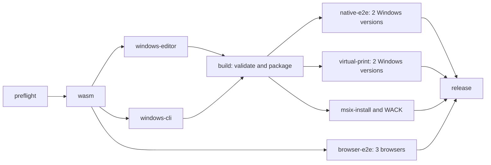

# Parallel Windows builds

The Windows workflow compiles the editor and the `native-skia` CLI on two
separate standard `windows-2025` runners. Both start after preflight and the
source-bound WASM build, alongside the three browser tests. The `build` job
joins the two components and creates the unsigned MSIX and portable ZIP without
compiling either runtime again.

The editor job runs the unchanged four native PDF policy tests with
`native-skia`, immediately after the default-feature native table regression.
Both tests use the existing debug test target directory; neither uses release
LTO. The CLI job builds only the production release binary, retaining its
Windows x64 target, `native-skia` features and upstream release profile.
Both jobs must pass before their source-bound components can be joined.
The editor also keeps GUI unit tests, fixture generation, frontend font audit
and dependency notices. The CLI and editor retain isolated Cargo target
directories, including separation between native tests and the GUI graph.

Each component records its role, repository, current workflow source commit,
run ID and attempt, pinned upstream versions, reviewed overlay/source
contract, rebuilt WASM record and complete file hashes. The join validates both
inventories and their matching source contracts, including x64 PE headers,
before creating a package payload. A retry may consume an earlier successful
component from the same immutable run and source, but never from a future
attempt or another source. Source trees, Cargo targets and
`node_modules` are not transferred. Components expire after one day and have
pre-upload limits of 64 MiB for the editor and 32 MiB for the CLI.

The editor retains component protocol 1. The protocol 2 CLI component carries
the runtime as deterministic gzip at `payload/Tools/rhwp.exe.gz`; compressed
transport and provenance together remain within the 32 MiB limit. The raw CLI
and the joined logical payload are each bounded to 96 MiB. Before staging, the
join requires one complete gzip member, validates its CRC and end of stream,
rejects trailing data or additional members, and checks the restored runtime's
raw size, SHA256 and x64 PE header. The component receipt records the raw
`Tools/rhwp.exe` runtime size and SHA256.

All existing release gates remain required. Store package authorization also
requires both producers to pass. Transport cleanup requires the complete,
same-run validated batch and all consumers to succeed; failed runs retain
inputs, successful PRs retain their unpublished package, and test evidence is
never deleted by the transport cleanup.

The earlier sequential candidate [run 38142625600](https://github.com/ATLKR/OpenGeul/actions/runs/38142625600)
took 57 minutes 41 seconds in its Windows build job and 15 minutes 38 seconds
in WASM. These are measured previous timings, not a prediction for the new
pipeline. The parallel pipeline's duration must be measured on a completed
run. It uses the existing public-repository standard runner policy with no
automatic caches or paid runners.

For local Windows builds, `scripts/build-msix.ps1 -WasmDirectory <directory>`
retains the complete sequential build. CI uses `-Phase Editor`, `-Phase Cli`
and `-Phase Package`; packaging requires both component directories and never
accepts an unverified standalone executable.
