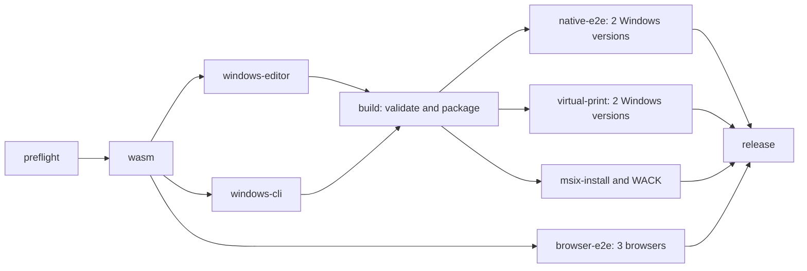

# Parallel Windows builds

The Windows workflow compiles the editor and the `native-skia` CLI on two
separate standard `windows-2025` runners. Both start after preflight and the
source-bound WASM build, alongside the three browser tests. The `build` job
joins the two components and creates the unsigned MSIX and portable ZIP without
compiling either runtime again.

The editor job runs the unchanged four native PDF policy tests with
`native-skia`, immediately after the default-feature native table regression.
Both tests use the existing debug test target directory; neither uses release
LTO. The CLI job builds only the production release binary, retaining its
Windows x64 target, `native-skia` features and upstream release profile.
Both jobs must pass before their source-bound components can be joined.
The editor also keeps GUI unit tests, fixture generation, frontend font audit
and dependency notices. The CLI and editor retain isolated Cargo target
directories, including separation between native tests and the GUI graph.

Each component records its role, repository, current workflow source commit,
run ID and attempt, pinned upstream versions, reviewed overlay/source
contract, rebuilt WASM record and complete file hashes. The join validates both
inventories and their matching source contracts, including x64 PE headers,
before creating a package payload. A retry may consume an earlier successful
component from the same immutable run and source, but never from a future
attempt or another source. Source trees, Cargo targets and
`node_modules` are not transferred. Components expire after one day and have
pre-upload limits of 64 MiB for the editor and 32 MiB for the CLI.

Common preparation writes the desktop Cargo manifest with LF line endings,
matching Tauri's editor-build rewrite. Both components still record and compare
its raw byte hash; line-ending differences are rejected by the join.

The editor retains component protocol 1. The protocol 2 CLI component carries
the runtime as deterministic gzip at `payload/Tools/rhwp.exe.gz`; compressed
transport and provenance together remain within the 32 MiB limit. The raw CLI
and the joined logical payload are each bounded to 96 MiB. Before staging, the
join requires one complete gzip member, validates its CRC and end of stream,
rejects trailing data or additional members, and checks the restored runtime's
raw size, SHA256 and x64 PE header. The component receipt records the raw
`Tools/rhwp.exe` runtime size and SHA256.

All existing release gates remain required. Store package authorization also
requires both producers to pass. Transport cleanup requires the complete,
same-run validated batch and all consumers to succeed; failed runs retain
inputs, successful PRs retain their unpublished package, and test evidence is
never deleted by the transport cleanup.

The historical candidates and the current qualified source run have these
measured Windows scopes:

| Source run | Measured Windows scope | Duration | Complete source workflow |
| --- | --- | --- | --- |
| [50 / 38142625600](https://github.com/ATLKR/OpenGeul/actions/runs/38142625600) | Sequential Windows build job | 57 minutes 41 seconds | Failed; not release-qualified |
| [61 / 38161639847](https://github.com/ATLKR/OpenGeul/actions/runs/38161639847) | First parallel producer start through successful package assembly | 40 minutes 14 seconds | Failed; not release-qualified |
| [64 / 38167617349](https://github.com/ATLKR/OpenGeul/actions/runs/38167617349), attempt 1 | Same parallel Windows scope | 39 minutes 53 seconds | Succeeded; source-qualified |

The historical Windows scope was 17 minutes 27 seconds (30.25%) shorter in
run 61 than run 50. Both complete source workflows failed, and they used
different source commits and runner executions. These observations do not
establish a qualified release, an end-to-end CI improvement, a controlled
causal comparison or a universal speedup. Job durations are not summed to
measure a parallel critical path.

Source run 64 is bound to `a51cb3547f9cbd8f090fb032f550810855feaed3` and
completed successfully with all 14 required source jobs and transport cleanup.
The Windows interval ran from 19:29:45 UTC to 20:09:38 UTC on 2026-10-11:
39 minutes 53 seconds, or 17 minutes 48 seconds (30.86%) shorter than the
failed run 50's successful sequential Windows build job. The complete source
workflow ran from 19:20:43 UTC to 20:14:58 UTC: 54 minutes 15 seconds. This
whole-CI duration is separate from the Windows interval; no fully successful
sequential whole-CI baseline is asserted. Fresh editor, CLI and WASM hashes,
MSIX/portable runtime parity and all required runtime gates were verified for
the [exact development release](https://github.com/ATLKR/OpenGeul/releases/tag/v1.1.2-dev.64.1).
These observations compare different commits and runner executions; they do
not establish a controlled causal estimate or universal speedup. The workflow
uses the existing public repository's standard runner policy with no automatic
caches or paid runners; account-wide billing and storage are outside this
workflow proof.

For local Windows builds, `scripts/build-msix.ps1 -WasmDirectory <directory>`
retains the complete sequential build. CI uses `-Phase Editor`, `-Phase Cli`
and `-Phase Package`; packaging requires both component directories and never
accepts an unverified standalone executable.
