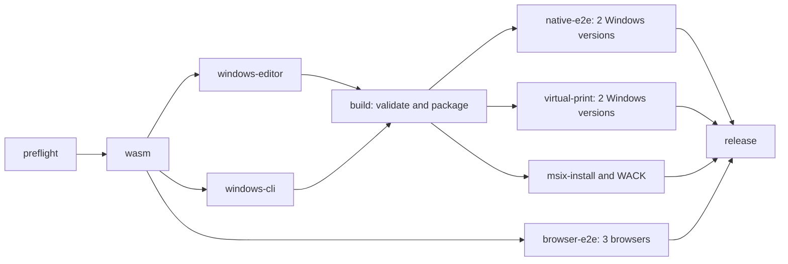

# Windows 병렬 빌드

Windows 워크플로는 편집기와 `native-skia` CLI를 별도의 표준 `windows-2025` 실행기 두 대에서 컴파일합니다. 둘 다 사전 점검과 소스가 연결된 WASM 빌드 뒤에 시작하며, 브라우저 테스트 3개도 함께 실행됩니다. `build` 작업은 두 구성요소를 결합하고 실행 파일을 다시 컴파일하지 않은 채 서명되지 않은 MSIX와 포터블 ZIP을 만듭니다.

편집기 작업은 기본 기능의 네이티브 표 회귀 테스트 바로 뒤에 기존 네이티브 PDF 정책 테스트 4개를 `native-skia`로 실행합니다. 두 테스트는 기존 디버그 테스트 대상 디렉터리를 사용하며 릴리스 LTO를 사용하지 않습니다. CLI 작업은 배포용 릴리스 바이너리만 빌드하고 Windows x64 대상, `native-skia` 기능과 업스트림 릴리스 프로필을 유지합니다. 두 작업 모두 통과해야 소스와 연결된 구성요소를 결합할 수 있습니다. 편집기는 GUI 단위 테스트, 테스트 자료 생성, 프런트엔드 글꼴 검사와 의존성 고지도 유지합니다. CLI와 편집기는 분리된 Cargo 대상 디렉터리를 유지하며 네이티브 테스트와 GUI 빌드 그래프도 분리합니다.

각 구성요소는 역할, 저장소, 현재 워크플로 소스 커밋, 실행 ID·시도 번호, 고정 업스트림 버전, 검토된 오버레이·소스 계약, 재빌드 WASM 기록과 전체 파일 해시를 기록합니다. 결합 작업은 패키지 내용을 만들기 전에 x64 PE 헤더를 포함한 두 목록과 소스 계약 일치를 검증합니다. 재시도에서는 동일한 변경 불가능한 실행·소스의 이전 성공 구성요소를 사용할 수 있지만, 미래 시도나 다른 소스의 것은 사용할 수 없습니다. 소스 트리, Cargo 대상과 `node_modules`는 전송하지 않습니다. 구성요소는 하루 뒤 만료되고 업로드 전 크기는 편집기 64 MiB, CLI 32 MiB로 제한합니다.

공통 준비 과정은 데스크톱 Cargo 매니페스트를 LF 줄바꿈으로 써서 Tauri 편집기 빌드의 재작성과 일치시킵니다. 두 구성요소 모두 여전히 원시 바이트 해시를 기록·비교하며 줄바꿈 차이는 결합 작업에서 거부합니다.

편집기는 구성요소 프로토콜 1을 유지합니다. 프로토콜 2 CLI는 실행 파일을 `payload/Tools/rhwp.exe.gz`의 결정적인 gzip으로 전달하며 압축 중간 산출물과 출처 정보의 합은 32 MiB 이내여야 합니다. 원시 CLI와 결합한 논리적 패키지 내용물은 각각 96 MiB로 제한합니다. 준비 전에 결합 작업은 완전한 gzip 멤버 하나를 요구하고 CRC와 스트림 끝을 검증합니다. 뒤따르는 데이터나 추가 멤버는 거부하며 복원한 실행 파일의 원시 크기, SHA256과 x64 PE 헤더를 확인합니다. 구성요소 확인 기록에는 원시 `Tools/rhwp.exe` 크기와 SHA256을 남깁니다.

모든 기존 릴리스 검증은 필수로 유지합니다. Store 패키지 승인도 두 생산 작업이 통과해야 합니다. 중간 산출물 정리는 완전한 동일 실행 검증 묶음과 모든 소비 작업 성공을 요구합니다. 실패 실행은 입력을 보존하고 성공 PR은 게시하지 않은 패키지를 보존하며, 이 정리에서 테스트 증거는 삭제하지 않습니다.

과거 후보와 검증된 소스 실행의 Windows 측정 범위는 다음과 같습니다.

| 소스 실행 | 측정한 Windows 범위 | 소요 시간 | 전체 소스 워크플로 |
| --- | --- | --- | --- |
| [50 / 38142625600](https://github.com/ATLKR/OpenGeul/actions/runs/38142625600) | 순차 Windows 빌드 작업 | 57분 41초 | 실패, 릴리스 검증 미통과 |
| [61 / 38161639847](https://github.com/ATLKR/OpenGeul/actions/runs/38161639847) | 첫 병렬 생산 작업 시작부터 성공한 패키지 조립까지 | 40분 14초 | 실패, 릴리스 검증 미통과 |
| [64 / 38167617349](https://github.com/ATLKR/OpenGeul/actions/runs/38167617349), 시도 1 | 동일한 병렬 Windows 범위 | 39분 53초 | 성공, 해당 소스 검증 통과 |

실행 61의 과거 Windows 구간은 실행 50보다 17분 27초(30.25%) 짧았습니다. 두 전체 소스 워크플로는 모두 실패했고 서로 다른 소스 커밋과 실행기 실행을 사용했습니다. 이 관찰만으로 검증된 릴리스, 전체 CI 개선, 통제된 인과 비교나 보편적인 속도 향상을 확인할 수 없습니다. 병렬 임계 경로를 측정할 때 작업별 시간을 합산하지 않습니다.

소스 실행 64는 `a51cb3547f9cbd8f090fb032f550810855feaed3`에 연결되어 있으며 필수 소스 작업 14개와 중간 산출물 정리가 모두 성공했습니다. Windows 구간은 2026-10-11 19:29:45 UTC부터 20:09:38 UTC까지 39분 53초였습니다. 전체는 실패했지만 순차 Windows 빌드는 성공했던 실행 50의 해당 빌드 작업보다 17분 48초(30.86%) 짧았습니다. 전체 소스 워크플로는 19:20:43 UTC부터 20:14:58 UTC까지 54분 15초였습니다. 이 전체 CI 시간과 Windows 구간은 별개이며, 모든 검증을 통과한 순차 전체 CI 기준이 있다고 주장하지 않습니다. 새 편집기·CLI·WASM 해시, MSIX·포터블 런타임 전체 파일 일치와 모든 필수 실행 검증은 [정확한 개발 릴리스](https://github.com/ATLKR/OpenGeul/releases/tag/v1.1.2-dev.64.1)에 대해 확인했습니다. 이 근거는 새 후보 1.1.3의 성공을 미리 입증하지 않습니다.

서로 다른 커밋과 실행기 실행을 비교한 관찰이므로 통제된 인과 효과나 보편적인 속도 향상을 확인하지 못합니다. 워크플로는 기존 공개 저장소의 표준 실행기 정책을 따르고 자동 캐시나 유료 실행기는 사용하지 않습니다. 계정 전체 청구와 저장 공간은 이 워크플로의 증명 범위 밖입니다.

로컬 Windows 빌드의 `scripts/build-msix.ps1 -WasmDirectory <directory>`는 전체 순차 빌드를 유지합니다. CI는 `-Phase Editor`, `-Phase Cli`, `-Phase Package`를 사용합니다. 패키징에는 두 구성요소 디렉터리가 모두 필요하며 검증되지 않은 단독 실행 파일은 받지 않습니다.
